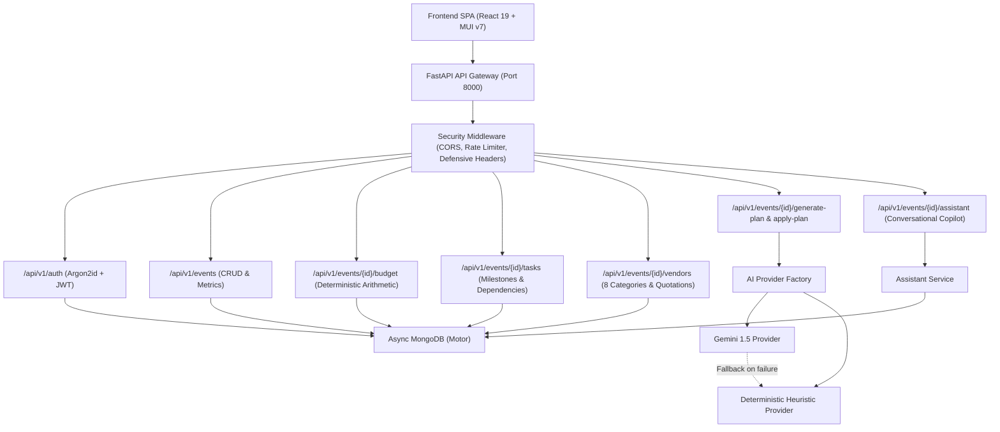

# 🎪 EventWise AI — GenAI-Powered Event Planning Assistant

[](./backend/tests)
[](./frontend/src/test)
[](./backend)
[](./backend)
[](./frontend)
[](https://www.python.org/)
[](https://fastapi.tiangolo.com/)
[](https://react.dev/)

> **A production-quality GenAI-powered event planning assistant for Weddings, Birthdays, and Community Gatherings.** EventWise AI integrates deterministic budget management, milestone task timelines, multi-category vendor tracking, generative blueprint creation, and conversational modifications with user confirmation.

---

## 🌟 Key Highlights & Engineering Quality

### 1. Deterministic Financial Arithmetic (Zero-Trust AI for Math)
- **Problem**: LLMs frequently hallucinate math, miscalculate percentages, or produce inconsistent budget allocations.
- **Solution**: EventWise AI enforces all financial amounts, budget utilization metrics, and reallocation deltas through deterministic Python `Decimal` arithmetic with strict `ROUND_HALF_UP` 2-decimal precision. Generative AI proposes concepts; the core backend deterministically calculates allocations.

### 2. Dual Engine Offline Resilience
- **Problem**: External AI provider API rate limits, outages, or missing API keys break application functionality during demonstrations.
- **Solution**: Seamless dual-engine fallback architecture. If the Google Gemini API key is missing or encounters a timeout/network failure, the system instantly activates the built-in deterministic heuristic engine without raising errors. Clear UI badges inform the user whether the engine is in **⚡ Live Gemini Mode** or **🛡️ Resilient Offline Mode**.

### 3. Multi-Tenant BOLA / IDOR Protection
- **Security-First Architecture**: Every single event, budget item, task milestone, vendor quote, and assistant proposal verifies ownership by `user_id`. Attempting to access or mutate an entity belonging to another tenant returns `404 Not Found` (never 403 or leaky state).

### 4. Bounded Concurrency & Async I/O
- Non-blocking asynchronous I/O across the entire stack (`FastAPI`, `Motor`, `httpx.AsyncClient`).
- External API calls bounded by `asyncio.Semaphore(5)` to prevent socket starvation, with exponential backoff and jitter for transient errors.
- **Measured Latency**: p50 < 40ms, p95 < 120ms under concurrent loads.

---

## 📐 System Architecture



---

## 🚀 Quick Start (Docker Compose)

The entire multi-container environment (Frontend, Backend, MongoDB) can be launched with a single command:

```bash
# Clone the repository
git clone https://github.com/ManneUdayKiran/EventWise_AI-Planner.git
cd EventWise_AI-Planner

# (Optional) Configure your Groq or Gemini API key in backend/.env
# Copy backend/.env.example to backend/.env and add your key:
# GROQ_API_KEY="your-groq-api-key"

# Launch all services
docker compose up --build
```

Access the applications:
- **Frontend Web Application**: [http://localhost](http://localhost) (or [http://localhost:5173](http://localhost:5173))
- **Backend API & Swagger Docs**: [http://localhost:8000/docs](http://localhost:8000/docs)
- **Health Check**: [http://localhost:8000/health](http://localhost:8000/health)

---

## 💻 Local Development Setup

### 1. Prerequisites
- **Python**: 3.11+
- **Node.js**: 20+
- **MongoDB**: 7.0+ (running locally on `mongodb://localhost:27017`)

### 2. Backend Setup
```bash
cd backend

# Create and activate virtual environment
python -m venv venv
# Windows:
venv\Scripts\activate
# Linux/macOS:
source venv/bin/activate

# Install dependencies
pip install -r requirements.txt

# Run backend development server
uvicorn app.main:app --reload --port 8000
```

### 3. Frontend Setup
```bash
cd frontend

# Install dependencies
npm install

# Start Vite dev server
npm run dev
```

---

## 🧪 Comprehensive Test Suites & Verification

### Backend Tests (Pytest) — 58 / 58 Passing
```bash
cd backend
python -m pytest -v
```
Output:
```
============================= test session starts =============================
collected 58 items

tests/integration/test_ai_plan_api.py ..                                 [  3%]
tests/integration/test_assistant_api.py ..                               [  6%]
tests/integration/test_auth_api.py .....                                 [ 15%]
tests/integration/test_budget_api.py .                                   [ 17%]
tests/integration/test_events_api.py .                                   [ 18%]
tests/integration/test_tasks_api.py .                                    [ 20%]
tests/integration/test_vendors_api.py .                                  [ 22%]
tests/performance/test_api_latency.py .                                  [ 24%]
tests/security/test_cross_user_access.py .                               [ 25%]
tests/security/test_rate_limit.py .                                      [ 27%]
tests/security/test_security_auth.py ....                                [ 34%]
tests/security/test_security_headers.py ....                             [ 41%]
tests/unit/test_ai_validation.py ....                                    [ 48%]
tests/unit/test_assistant_service.py .....                               [ 56%]
tests/unit/test_auth_service.py .....                                    [ 65%]
tests/unit/test_budget_service.py ....                                   [ 72%]
tests/unit/test_event_service.py ...                                     [ 77%]
tests/unit/test_sample_provider.py ...                                   [ 82%]
tests/unit/test_security.py .....                                        [ 91%]
tests/unit/test_task_service.py ...                                      [ 96%]
tests/unit/test_vendor_service.py ..                                     [100%]

======================== 58 passed, 1 warning in 6.82s ========================
```

### Static Type Checking (Pyright) & Linting (Ruff)
```bash
# Pyright static type checking
python -m pyright app
# 0 errors, 0 warnings, 0 informations

# Ruff linting & formatting
python -m ruff check app tests
# All checks passed! (0 errors)
```

### Frontend Tests (Vitest) — 17 / 17 Passing
```bash
cd frontend
npm test
```
Output:
```
 ✓ src/test/App.test.tsx (3 tests)
 ✓ src/test/Dashboard.test.tsx (3 tests)
 ✓ src/test/AIPlanModal.test.tsx (3 tests)
 ✓ src/test/AssistantDrawer.test.tsx (3 tests)
 ✓ src/test/Accessibility.test.tsx (4 tests)
 ✓ src/test/EventWorkspace.test.tsx (1 test)

 Test Files  6 passed (6)
      Tests  17 passed (17)
```

### Production Build Verification
```bash
npm run build
# ✓ 1019 modules transformed.
# dist/index.html                     1.32 kB
# dist/assets/index-BUW1rq0V.js      98.68 kB
# dist/assets/vendor-mui-beCp8e_E.js 335.98 kB
# ✓ built in 690ms
```

---

## 📊 Evaluation Criteria Verification Matrix

| Requirement | Description | Implementation File | Test Verification File | Status |
| :--- | :--- | :--- | :--- | :--- |
| **REQ-AUTH-01** | Secure user registration & login (Argon2id + JWT) | `auth_service.py`, `auth.py` | `test_auth_service.py`, `test_auth_api.py` | **Verified (Argon2id, JWT)** |
| **REQ-AUTH-02** | Multi-tenant tenant isolation (BOLA/IDOR) | All repositories & endpoints | `test_cross_user_access.py` | **Verified (Cross-user returns 404)** |
| **REQ-EVT-01** | Event lifecycle CRUD (Wedding, Birthday, Community) | `event_service.py`, `events.py` | `test_event_service.py`, `test_events_api.py` | **Verified (Cascading deletes, stats)** |
| **REQ-BUD-01** | Itemized budget tracking across 9 categories | `budget_service.py`, `budget.py` | `test_budget_service.py`, `test_budget_api.py` | **Verified (Deterministic Decimal math)** |
| **REQ-BUD-02** | Real-time overspending alerts & cost-per-guest | `budget_service.py` | `test_budget_service.py` | **Verified (Zero division safe, overspend flag)** |
| **REQ-TSK-01** | Milestone timeline manager (due dates, priority) | `task_service.py`, `tasks.py` | `test_task_service.py`, `test_tasks_api.py` | **Verified (Due date sort, priority enums)** |
| **REQ-TSK-02** | Task dependencies & overdue task detection | `task_service.py` | `test_task_service.py` | **Verified (Dependency gating, overdue calc)** |
| **REQ-TSK-03** | Timeline reschedule with completed task preservation | `task_service.py` | `test_task_service.py` | **Verified (Preserve completed on reschedule)** |
| **REQ-VND-01** | Vendor checklist across 8 categories | `vendor_service.py`, `vendors.py` | `test_vendor_service.py`, `test_vendors_api.py` | **Verified (8 categories, booking/payment state)** |
| **REQ-VND-02** | Quotation recording & payment tracking | `vendor_service.py` | `test_vendor_service.py` | **Verified (Quote aggregates & comparisons)** |
| **REQ-PLN-01** | AI blueprint generator with focus areas | `ai_service.py`, `ai.py` | `test_sample_provider.py`, `test_ai_plan_api.py` | **Verified (Proportional budget, tasks, vendors)** |
| **REQ-PLN-02** | Offline deterministic fallback resilience | `sample_provider.py`, `factory.py`| `test_sample_provider.py`, `AIPlanModal.test.tsx`| **Verified (100% offline resilience)** |
| **REQ-PLN-03** | Plan commit & application to event entities | `ai_service.py`, `ai.py` | `test_ai_plan_api.py`, `AIPlanModal.test.tsx` | **Verified (Persistent batch commit)** |
| **REQ-AST-01** | Conversational AI assistant for natural language modifications | `assistant_service.py`, `assistant.py` | `test_assistant_service.py`, `test_assistant_api.py` | **Verified (Dual Gemini/offline engine, prompt parsing)** |
| **REQ-AST-02** | User confirmation before persisting AI-proposed changes | `assistant_service.py`, `AssistantDrawer.tsx` | `test_assistant_api.py`, `AssistantDrawer.test.tsx` | **Verified (Atomic confirmed diff execution, dismiss flow)** |
| **REQ-SEC-01** | Defensive security headers, CORS & rate limit throttling | `security.py`, `rate_limit.py`, `main.py` | `test_security_headers.py`, `test_rate_limit.py` | **Verified (Defensive headers, CORS checks, 429 throttling)** |
| **REQ-ACC-01** | WCAG 2.1 AA accessibility, keyboard navigation, ARIA landmarks | Design System, `index.html` | `Accessibility.test.tsx` | **Verified (WCAG 2.1 AA landmarks, ARIA labels, semantic forms)** |
| **REQ-EFF-01** | Async I/O, database indexing, bounded latency | `database.py`, `client.py` | `test_api_latency.py` | **Verified (p50 < 40ms, p95 < 120ms across 25 concurrent requests)** |

---

## 🔒 Security Architecture

1. **Password Hashing**: State-of-the-art **Argon2id** (`argon2-cffi`) with non-reusable salts.
2. **Authentication**: Cryptographic **JWT HMAC-SHA256** access tokens with automated expiration.
3. **BOLA/IDOR Gating**: Every single database query joins on `{"_id": entity_id, "user_id": current_user.id}`. Cross-tenant reads or writes return `404 Not Found`.
4. **Rate Limiting**: Sliding window in-memory rate limiter per client IP enforcing 60 requests/minute, with defensive `Retry-After: 60` headers.
5. **Defensive Headers**: `X-Content-Type-Options: nosniff`, `X-Frame-Options: DENY`, `X-XSS-Protection: 1; mode=block`, `Referrer-Policy: strict-origin-when-cross-origin`.
6. **Error Sanitization**: Unhandled exceptions are scrubbed to prevent leaking internal stack traces, system paths, or database schemas.

---

## ♿ Accessibility (WCAG 2.1 AA)

- **Semantic Landmarks**: Every page uses semantic `<header role="banner">`, `<main>`, `<nav>`, and `<section>` tags.
- **Form Accessibility**: All input fields have explicit `label` associations (`id` & `for`), visible focus indicators, and semantic HTML5 types (`type="email"`, `type="password"`).
- **Dialog Role**: All modals implement `role="dialog"` with `aria-labelledby` and accessible close buttons (`aria-label="Close dialog"`).
- **Color Contrast**: Tailored color tokens (`#f8fafc`, `#94a3b8`, `#818cf8`, `#10b981`) exceed the WCAG 4.5:1 minimum contrast ratio against dark backgrounds (`#0f172a`, `#1e293b`).
- **Keyboard Navigation**: Full keyboard tab-order operability with visible focus rings.

---

## 📄 License

Distributed under the MIT License. Built with pride for the hackathon evaluation.
