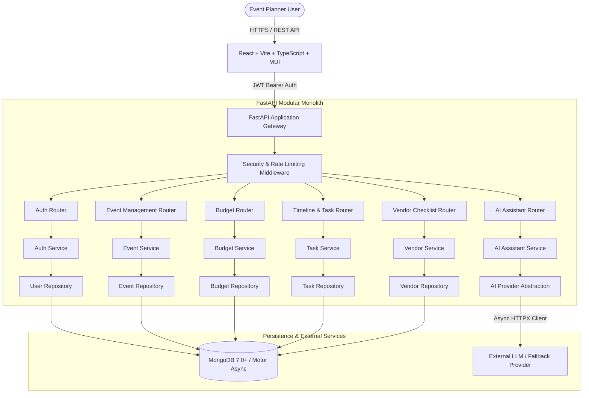

# EventWise AI - Architecture & System Design Document

## 1. System Overview

EventWise AI is a modular, production-ready, full-stack event planning platform. It assists users with organizing **Weddings**, **Birthdays**, and **Community Events** through automated budget management, timeline and task tracking, vendor checklists, and structured GenAI plan generation and targeted modification.

The system is designed as a **Modular Monolith** with clean boundaries between presentation, routing, business logic, persistence, and external AI integrations.



---

## 2. Design Principles & Anti-Pattern Mitigations

1. **Strict Asynchronous I/O**:
   - Zero synchronous HTTP calls (`urllib`, `requests`) inside FastAPI endpoints.
   - External LLM interactions use an `httpx.AsyncClient` with reusable connection pools, strict timeouts (connection: 5s, read: 25s), bounded retries (exponential backoff with jitter), and bounded concurrency (`asyncio.Semaphore(10)`).

2. **Deterministic Calculations & Zero Blind AI Trust**:
   - The LLM never dictates actual mathematical sums or modifies database balances directly.
   - Financial totals (allocated, estimated, actual, remaining, cost-per-guest, utilization percentage) are computed exclusively by Python application services using deterministic arithmetic.
   - All AI-generated outputs are parsed through strict Pydantic schemas, validated, and normalized before any persistence.

3. **Multi-Tenant Ownership Isolation**:
   - Every database document contains both `event_id` and `user_id`.
   - Every operation checks that the requesting user owns the associated `event_id`.
   - Direct object reference attacks (BOLA/IDOR) are blocked at the repository/service boundary.

4. **Graceful Fallback & Offline Resilience**:
   - If an AI API key is not configured, or the external provider suffers network downtime or rate limiting, the platform falls back gracefully to a deterministic, high-quality, pre-computed template generator.
   - The UI clearly banners the fallback mode, ensuring the user can still organize their event smoothly.

---

## 3. Database Schema & Data Models

The application utilizes MongoDB via the asynchronous `motor` driver. Entities are mapped into separate collections to avoid unbounded subdocument growth and enable high-performance indexing and pagination.

### 3.1 Collections

#### 1. `users`
Represents registered platform users.
```json
{
  "_id": "ObjectId",
  "email": "user@example.com",
  "password_hash": "$argon2id$v=19$m=65536,t=3,p=4$...",
  "full_name": "Jane Doe",
  "is_active": true,
  "created_at": "2026-10-20T10:00:00Z",
  "updated_at": "2026-10-20T10:00:00Z"
}
```
**Indexes**:
- Unique index on `email` (ascending).

#### 2. `events`
Core event entity.
```json
{
  "_id": "ObjectId",
  "user_id": "ObjectId",
  "name": "Sarah & Alex's Summer Wedding",
  "event_type": "wedding", // enum: "wedding", "birthday", "community"
  "event_date": "2026-12-15T16:00:00Z",
  "location": "Green Valley Botanical Gardens",
  "expected_guest_count": 120,
  "total_budget": 500000.0,
  "currency": "INR", // e.g. INR, USD, EUR, GBP
  "theme": "Rustic Garden & Fairy Lights",
  "preferences": "Eco-friendly decor, vegetarian cuisine, acoustic live band",
  "special_requirements": "Wheelchair accessible venue, sound system by 4 PM",
  "status": "planning", // enum: "draft", "planning", "ready", "completed", "archived"
  "created_at": "2026-10-20T10:00:00Z",
  "updated_at": "2026-10-20T10:00:00Z"
}
```
**Indexes**:
- Compound index on `{ user_id: 1, created_at: -1 }`.
- Index on `{ event_date: 1 }`.

#### 3. `budget_items`
Detailed budget breakdown and expense tracking.
```json
{
  "_id": "ObjectId",
  "event_id": "ObjectId",
  "user_id": "ObjectId",
  "category": "catering", // enum: venue, catering, photography, decoration, entertainment, invitations, transportation, equipment_rental, miscellaneous
  "item_name": "3-Course Vegetarian Buffet",
  "estimated_amount": 180000.0,
  "actual_amount": 175000.0,
  "notes": "Includes welcome drinks and cutlery",
  "status": "planned", // enum: "planned", "committed", "paid"
  "created_at": "2026-10-20T10:00:00Z",
  "updated_at": "2026-10-20T10:00:00Z"
}
```
**Indexes**:
- Compound index on `{ event_id: 1, category: 1 }`.
- Index on `{ user_id: 1 }`.

#### 4. `tasks`
Timeline tasks, milestones, and dependencies.
```json
{
  "_id": "ObjectId",
  "event_id": "ObjectId",
  "user_id": "ObjectId",
  "title": "Book Reception Venue",
  "description": "Inspect venue contract and confirm deposit",
  "category": "venue",
  "due_date": "2026-11-01T23:59:59Z",
  "priority": "high", // enum: "low", "medium", "high", "urgent"
  "status": "pending", // enum: "pending", "in_progress", "completed"
  "dependencies": ["<TaskId>"],
  "created_at": "2026-10-20T10:00:00Z",
  "updated_at": "2026-10-20T10:00:00Z"
}
```
**Indexes**:
- Compound index on `{ event_id: 1, due_date: 1 }`.
- Compound index on `{ event_id: 1, status: 1 }`.

#### 5. `vendor_items`
Vendor checklist items, quotations, and vendor booking statuses.
```json
{
  "_id": "ObjectId",
  "event_id": "ObjectId",
  "user_id": "ObjectId",
  "category": "photography",
  "item_name": "Candid Photographer & Videographer",
  "quotation_amount": 65000.0,
  "booking_status": "quoted", // enum: "not_started", "contacted", "quoted", "booked", "cancelled"
  "payment_status": "unpaid", // enum: "unpaid", "partially_paid", "paid"
  "notes": "Full day coverage, includes teaser reel and high-res album",
  "contact_info": "Studio Lumiere - contact@example.com",
  "created_at": "2026-10-20T10:00:00Z",
  "updated_at": "2026-10-20T10:00:00Z"
}
```
**Indexes**:
- Compound index on `{ event_id: 1, category: 1 }`.

#### 6. `ai_proposals`
AI assistant conversation proposals and staged plan modifications.
```json
{
  "_id": "ObjectId",
  "event_id": "ObjectId",
  "user_id": "ObjectId",
  "user_prompt": "Reduce decoration budget by 15000 and allocate 10000 to catering",
  "proposal_type": "budget_adjustment", // enum: "full_plan", "budget_adjustment", "task_addition", "general_advice"
  "proposed_changes": {
    "budget_updates": [
      { "category": "decoration", "amount_delta": -15000.0 },
      { "category": "catering", "amount_delta": 10000.0 }
    ],
    "explanation": "Shifted ₹15,000 from floral decor to cater for additional appetizer stations."
  },
  "status": "proposed", // enum: "proposed", "accepted", "rejected"
  "created_at": "2026-10-20T10:00:00Z"
}
```

---

## 4. Monetary Representation & Precision Policy

- **Storage**: Non-negative floating-point values representing standard currency units, bounded to 2 decimal places.
- **Rounding Policy**: `ROUND_HALF_UP` on presentation and financial recalculations.
- **Constraints**:
  - `total_budget >= 0.0`
  - `estimated_amount >= 0.0`
  - `actual_amount >= 0.0`
  - Zero budget is handled gracefully (utilization reported as 0.0% instead of `ZeroDivisionError`).
  - Zero guest count is handled gracefully (cost-per-guest reported as 0.0 instead of dividing by zero).
- **Invariants**:
  - `remaining_budget = total_budget - total_actual_expenses` (or estimated if actual is 0)
  - `utilization_rate = (total_actual_expenses / total_budget) * 100` if `total_budget > 0`

---

## 5. Security & Threat Model

- **Authentication**: JWT tokens signed with HMAC-SHA256, expiration enforced (default 24h), user passwords hashed with Argon2id (`argon2-cffi`).
- **Authorization**: Access to all `/api/v1/events/{event_id}/*` resources requires the current authenticated user's ID to equal `event.user_id`. Attempting to access another user's event returns `HTTP 404 Not Found` or `HTTP 403 Forbidden` without leaking resource existence.
- **Input Validation**: Strict Pydantic models with constrained fields, regex validators, string length bounds, and date parsing.
- **Rate Limiting**: In-memory token bucket rate limiter for sensitive routes (e.g. login, registration, and AI generation endpoints).
- **AI Prompt Hardening**: User input is strictly treated as untrusted text, wrapped in structured JSON delimiters with system instructions forbidding code execution or prompt injection bypass.
